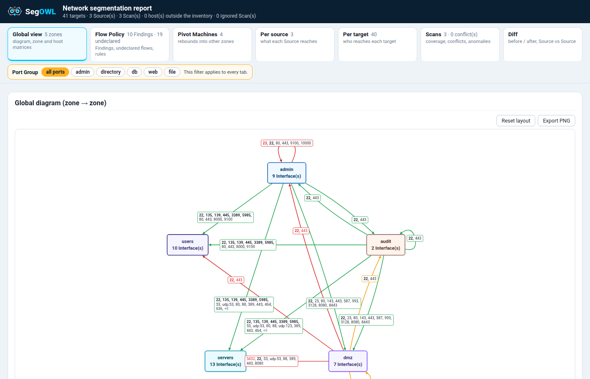
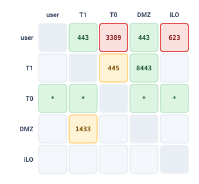
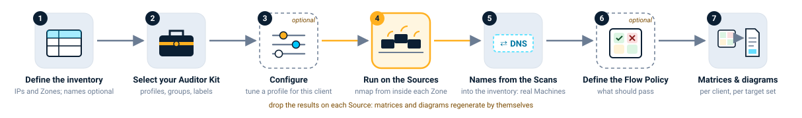
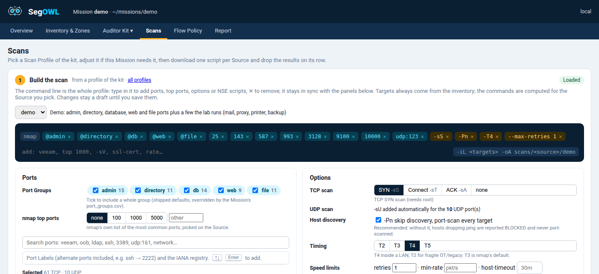

<p align="center"></p>

<h1 align="center">SegOWL</h1>

<p align="center">
  <b>Network segmentation testing, from nmap to the report.</b><br>
  Scan from inside every Zone, see what really crosses, set it against what the client says should.<br>
  <i>Not another scanner: SegOWL builds the nmap command, then reads its results.</i>
</p>

<p align="center">
  
  
  
  <a href="LICENSE"></a>
  <a href="https://marcrow.github.io/segowl/"></a>
</p>

<p align="center"></p>

## Why SegOWL

For pentesters and auditors who review a network segmentation.

| | |
|---|---|
| 🎯 **Rigour** | The same optimised nmap from every Source, against the whole inventory. Nothing forgotten, nothing to rerun. |
| 👁️ **Visibility** | Thousands of nmap answers become one matrix and one diagram per Zone and per Source. |
| 📄 **Restitution** | Findings against the client's Flow Policy, diagrams ready for your report, one offline HTML file. |

**Without SegOWL** you grep, then grep again:

```console
$ grep -h "3389/open" scans/*/*.gnmap | cut -d' ' -f2 | sort -u
# which of these are really not allowed? any of them in T0?
# then again for 445, 5985, 623… per Zone, per Source
```

**With SegOWL** the same scans fit on one screen: 2 Findings, 2 undeclared flows to decide.

<p align="center"></p>

## How it works

<p align="center"></p>

Everything lives in one **Mission folder** (inventory, scans, policy): no database, easy to archive with the
engagement.

<p align="center"></p>

- **Build the right nmap command**: ports found by product, tag or vendor (2 700+ Port Labels, IT and OT),
  options explained, one script per Source.
- **Several Sources, one method**: each Source scans the whole inventory minus itself; the coverage is
  complete the first time.
- **Findings, not noise**: only an explicit deny makes a Finding; undecided open flows are listed apart,
  never buried.
- **Retest after the fix**: drop the new Scan next to the old one, the change shows cell by cell.
- **Your method travels**: Kits carry your Scan Profiles, Port Groups and Port Labels from Mission to Mission.

## Quick start

Python 3.10+ and nothing else. nmap is only needed on the machines you scan from.

```bash
git clone https://github.com/marcrow/segowl.git && cd segowl
python3 -m segowl serve demo/        # the app on http://127.0.0.1:8000/
```

`demo/` is a complete Mission (a fictitious company in five Zones, real scans from three Sources, a Flow
Policy): it opens straight on Findings to look at. Your own engagement:

```bash
python3 -m segowl serve ~/missions/acme/   # folder created if missing, the app guides you from there
python3 -m segowl ~/missions/acme/         # or just regenerate the offline report
```

**Want to run real scans without a client network?** `lab/` rebuilds the demo network with Docker (one
network per Zone, a firewall applying the expected flows): `python3 lab/lab.py up`.
See the [lab guide](https://marcrow.github.io/segowl/guide/lab/).

## Documentation

📘 **[User guide](https://marcrow.github.io/segowl/)**: the Mission folder, scanning from each Source, the
Flow Policy, reading the report, tips and best practices.

## Development

```bash
uv run pytest                                        # tests (UPDATE_SNAPSHOTS=1 to accept a view change)
uv run ruff check . && uv run ruff format --check .  # lint + format
```

Domain vocabulary in [`GLOSSARY.md`](GLOSSARY.md), design decisions in [`docs/adr/`](docs/adr/).
