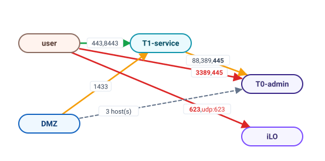
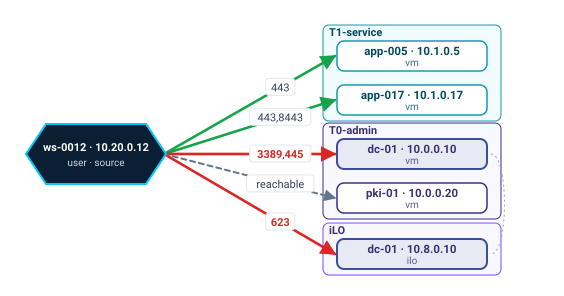
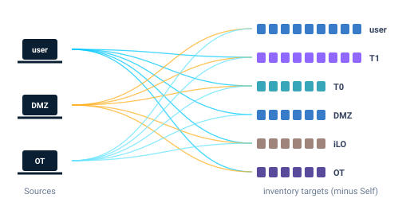
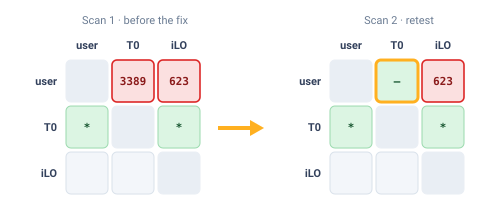

<p align="center"></p>

# SegOWL — segmentation matrix + Mermaid + HTML report

**Rigour in the scans. Visibility on the flows. Quality in the report.** You know nmap. SegOWL turns the
scans you run from inside the perimeter into the two views a segmentation review needs, per Zone and per
Source, set against what the client says should pass.

- **Rigour**: the same optimised nmap from every Source, against the whole inventory: nothing forgotten,
  nothing to rerun.
- **Visibility**: thousands of nmap answers become one view per Zone and one per Source: what passes, and
  what should not.
- **Restitution**: matrices and diagrams per client and per target selection, ready for your pentest or
  audit report.

## Two views of the same scans

**Per Zone**: every Zone pair, the open ports on each edge.

<p align="center"></p>

**Per Source**: everything one Source reaches, grouped by Zone.

<p align="center"></p>

🟥 ✕ open, denied: Finding · 🟧 ? open, undeclared · 🟩 ✓ open, allowed · dashed: reachable, no open port ·
port numbers: **bold** = admin port, red = denied by the Flow Policy

## The work process

<p align="center"></p>

## Why SegOWL

**Without SegOWL**, you grep, then grep again:

```console
$ grep -h "3389/open" scans/*/*.gnmap | cut -d' ' -f2 | sort -u
# which of these are really not allowed? any of them in T0?
# then again for 445, 5985, 623… per Zone, per Source
# did I think of every grep? did I find every Finding?
```

**With SegOWL**, the same outputs fit on one screen: 2 Findings, 2 undeclared flows to decide
(from ↓ to →).

<p align="center"></p>

**Several Sources, one method**: the same profile runs from every Source against the whole inventory
minus its own Machine; the coverage is complete the first time.

<p align="center"></p>

**Retest after the fix**: drop the new Scan next to the old one; the change shows cell by cell.

<p align="center"></p>

### What it brings you

- **Build the right nmap command**: ports
  found by product, tag or vendor, options explained, the exact command shown live.
- **Nothing forgotten, nothing to
  rerun**: one script per Source, targets = the whole inventory minus the Source.
- **Your method, shared and improved**:
  kits carry your Scan Profiles, Port Groups and Port Labels from audit to audit.
- **Step back over the data**: one matrix
  and one graph per Zone and per Source instead of thousands of nmap answers.
- **Findings, not noise**: only an explicit
  deny makes a Finding; undecided open flows are listed apart, never buried.
- **Retest and compare**: add Scans at any
  time, compare runs cell by cell.
- **Straight into your report**: matrices and
  diagrams per client or target set, plus the offline HTML report.

## Try it: demo and lab

**Demo, no scan needed.** `demo/` is a complete Mission: a fictitious company in five Zones, real nmap Scans
from three Sources and a Flow Policy, so the matrices open with Findings and undeclared flows to decide on.

```bash
python3 -m segowl serve demo/      # the app on http://127.0.0.1:8000/
python3 -m segowl demo/            # or the offline report only, in demo/report/
```

Edit it freely: git ignores your changes there (see `demo/README.md`).

**Lab, to run the scans yourself.** `lab/` simulates that network with Docker: one network per Zone, one tiny
container per Machine, a firewall applying `lab/flows.csv`, a DNS server for the names. The Sources run the scripts
the app generates, so the whole on-site flow can be tried end to end. Needs Docker only, no root on the host.

```bash
python3 lab/lab.py up                              # ~15 s, writes mission-lab/inventory.csv
python3 -m segowl serve mission-lab/               # add the Sources 10.10.0.10, 10.20.0.50, 10.40.0.10
python3 lab/lab.py run ~/Downloads/segowl-<profile>.zip   # results in lab/out/scans/<Source>/
python3 lab/lab.py down
```

The Machines, Zones and planted cases are described in `lab/hosts.csv`, the firewall rules in `lab/flows.csv`;
change them and run `up` again. `python3 lab/lab.py demo` rebuilds the demo's Scans from the lab.

## Workflow

Everything for one engagement lives in a **mission folder**:
```
mission/
  inventory.csv            ip;zone;type;name
  port_groups.csv          optional, overrides the default Port Groups
  flow_policy.csv          optional, the expected flows
  scans/<source_ip>/*.xml  any file name, one folder per Source
  report/                  generated
```

1. **Inventory** `inventory.csv` (`;` separator, optional header), `type` in snake_case:
   ```
   ip;zone;type;name
   10.0.2.1;internal;vm;app-01
   ```
   Extra columns (owner, criticality, OS, notes...) are allowed and shown in the report,
   with no logic attached; a header line is then required to name them:
   `ip;zone;type;name;owner;criticality`.

   Multi-interface machines (admin, service, iLO, monitoring...): one row per
   interface, same `name`. Without a name, the machine = the IP. A duplicate IP is an error.
   ```
   10.0.2.1;T1-service;vm;app-01
   10.9.0.1;T0-admin;vm;app-01
   10.8.0.1;ilo;ilo;app-01
   ```

2. **Scans** — launched *from each Source*, stored in `scans/<source_ip>/`:
   ```bash
   mkdir -p mission/scans/$SRC_IP && cd mission/scans/$SRC_IP
   nmap -Pn -p- -oA broad <targets>          # through proxychains/SOCKS if pivoting
   nmap -Pn -p 8443,9200 -oA follow-up <ip>  # any later follow-up, any parameters
   ```
   A Source may have **any number of Scans**: they are combined into its Source View
   (the most permissive state of a port wins, see `docs/adr/0001-*`; disagreements are kept).
   Keep the **XML** output: it is the reference format, the only one telling which ports
   were tested (Coverage). For one scan written in several formats (`-oA`), xml > gnmap > nmap.
   Avoid `--open`: closed ports are what reveals a REACHABLE flow.
   `--top-ports N` works too: nmap writes the expanded port list in the XML.
   To **take a Scan out** (e.g. one that conflicts with the others, see the Conflicts table of the
   Scans tab), move its file into a sub-folder of its source folder, e.g.
   `scans/<source_ip>/excluded/`: it is no longer read, only listed as excluded.
   A source folder that is not an inventory IP is **ignored** and listed in the terminal and
   the Anomalies tab. The legacy layout `scans/<source_ip>.xml` is still accepted.

3. **Generation**:
   ```bash
   python3 -m segowl mission/ --host-graph
   python3 -m segowl -i inventory.csv -s ./scans/ -o ./report/   # explicit paths (override)
   ```
   Run from the repository root: no installation and no dependency needed (Python >= 3.10).
   `pip install .` also provides a `segowl` command.

## Port Groups
Named sets of ports (`admin`, `directory`, `db`, `web`, `file`) shipped in
`segowl/defaults/port_groups.csv`. A `mission/port_groups.csv` (`group;ports`, e.g.
`admin;22,3389,5985,udp:161`) replaces a group of the same name or adds new ones.
The **Port Group** chips under the report's tabs restrict every tab (matrices, diagrams, tables)
to the OPEN flows on that group's ports. Open `admin` ports are always in bold, in matrix cells
and on diagram edges.

## Flow Policy (optional)
Without a Flow Policy the tool shows the views and the auditor judges: there are no Findings.
With `mission/flow_policy.csv` (or `--policy FILE`), every OPEN flow is evaluated:
```
src;dst;ports;action;comment
user;dmz;443;allow;web only
user;dmz;*;deny;
user;dc-01;*;allow;the machine rule beats the zone rule
```
- `src` / `dst`: a Zone, a Machine or `*`; `ports`: `*`, `22,443`, `8000-8100`, `udp:161`,
  `@admin` (Port Group), combinable; `action`: `allow` / `deny` (empty = no decision yet, skipped).
- The most specific rule wins: src (Machine > Zone > `*`), then dst, then ports (listed > `*`);
  at equal specificity `deny` wins (`docs/adr/0002-*`).
- An explicitly denied flow is a **Finding**; a flow no rule covers is **undeclared**, never a Finding.
  In the example: user -> dmz:22 is a Finding, user -> dmz:443 and user -> dc-01:* are allowed.
- The report gains a Flow Policy tab (Findings, undeclared flows, rules and how many flows each
  decided) and colours OPEN flows by status: red denied, amber undeclared, green allowed.

## Scan Diff
The **Diff** tab compares the open ports seen by any two Scans or Source Views: over time
(same Source, before / after a fix) or across Sources (what one sees that the other does not).
A port is *added* / *removed* only if the other side tested it; otherwise it is *not comparable*
(XML Coverage required).

## Pivot Machines and asymmetric flows
- **Pivot Machines** (Global view): machines whose interfaces span several zones and that a
  Source reaches OPEN. From the Source's zone they are a one-hop path to the machine's other
  zones (e.g. a user workstation reaching the service interface of a server also in T0).
- **Asymmetric flows** (Anomalies tab): A reaches B (OPEN or closed ports) while B -> A is
  blocked, typically a one-way firewall rule. Reported only when both are Sources and both
  directions tested common ports.

## Self exclusion
All interfaces of the source machine are always removed from the results: a scan that
sees itself locally typically shows many "open" ports that would skew the matrix.

## Outputs
- `report.html`         : **standalone tabbed report** (Global view / Flow Policy / Pivot Machines /
  Per source / Per target / Scans / Diff). The Scans tab lists every Scan (file, date, command, tested
  ports, conflicts), the Coverage per target and the anomalies; matrix cells show in a tooltip the
  Scans behind their verdict.
- `matrix_hosts.md/.csv`: consolidated host -> host matrix
- `matrix_zones.md`     : consolidated zone -> zone matrix
- `exposure_targets.md` : target-oriented view (who reaches what)
- `segmentation.mmd`    : global zone Mermaid
- `mermaid/<ip>.mmd`    : per-source Mermaid
- `segmentation_hosts.mmd` : global host Mermaid (`--host-graph` option)
- `findings.md`         : Findings and undeclared flows (only with a Flow Policy)
- `observed_flows.csv`  : one row per Source -> Interface -> open port (plus reachable / alive
  pairs), with machine, zone, type and free columns on both sides, Flow Policy decision, Scans
- `observed_zone_flows.csv` : observed OPEN flows per zone pair and port **in Flow Policy format**
  with an empty `action`: fill it (allow / deny) and save it as `flow_policy.csv` to start a policy


## -Pn mode
`-Pn` scans are supported natively (and even recommended): the option is auto-detected
from the nmap file header, or can be forced with `--pn`. In -Pn mode the "host up" state
(always true) is ignored; the verdict relies only on port states (open/closed/filtered).
Benefit: blocked targets show up as `filtered` (-> blocked) instead of being absent.

## Verdicts
- `OPEN`  : >=1 open port -> service reachable
- `o`     : closed ports (RST) -> L4 flow admitted up to the host (permeable segmentation, no service)
- `~`     : alive (answers ping/ARP), no port getting through -> scan it deeper; outside `-Pn` only
- `x`     : down, or filtered only under `-Pn` -> blocked
- `.`     : target absent from the scan output (unseen)

## Graphs
Each zone has its own hue on its frame and title, never red, amber or green: those belong to the
Flow Policy (red Finding, amber undeclared, green allowed), always shown with an icon. Each
multi-interface machine has its own colour; single-interface machines stay white.

## HTML report (offline)
The report's diagrams are drawn by Cytoscape.js (`segowl/assets/cytoscape.min.js`, MIT, shipped in
the repo, see `docs/adr/0005-cytoscape-for-network-diagrams.md`), inlined into `report.html` with
the rest of its scripts: the report is self-contained and renders without network. The `.mmd`
files stay plain Mermaid text, to paste into documents.

## Web app (in progress)
```bash
python3 -m segowl serve mission/              # http://127.0.0.1:8000/, folder created if missing
python3 -m segowl user add alice              # writes ~/.config/segowl/users (scrypt), login then required
python3 -m segowl serve mission/ --host 0.0.0.0 --cert cert.pem --key key.pem   # shared server, HTTPS
```
The app reads and writes the same mission folder (no database, `docs/adr/0003-*`, `docs/adr/0004-*`):
the report is regenerated whenever a mission file changes, by hand or from the app. Without a users file
it only listens on loopback. Menu in audit order: Overview · Inventory & Zones · Auditor Kit (Scan
Profiles, Port Groups, Port Labels, Kits: the auditor's tooling, carried from Mission to Mission) · Scans
(build the scan, then run it from each Source) · Flow Policy · Report.

## Development
```bash
uv run pytest                                        # tests (UPDATE_SNAPSHOTS=1 to accept a view change)
uv run ruff check . && uv run ruff format --check .  # lint + format
```
Layout: `segowl/` — `inventory.py` (CSV), `nmap.py` (discovery + parsers), `verdict.py`,
`analysis.py` (matrices), `render/` (Markdown/CSV, Mermaid, HTML + `assets/`), `cli.py`.
Domain vocabulary: `GLOSSARY.md`; decisions: `docs/adr/`.
