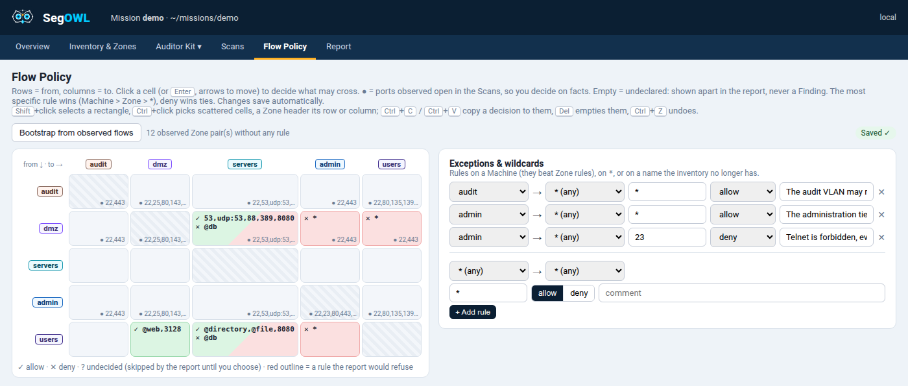

# Flow Policy

What the client says may cross, Zone by Zone. Optional: without it SegOWL still shows every view and you
judge; there are simply no Findings.



## Findings, not noise

| Status | When | Shown |
|---|---|---|
| 🟥 **Finding** | An open flow a rule explicitly **denies** | red, ✕ |
| 🟧 **Undeclared** | An open flow no rule covers | amber, ?, listed apart, never a Finding |
| 🟩 **Allowed** | An open flow a rule allows | green, ✓ |

Only an explicit deny makes a Finding ([ADR 0002](../adr/0002-flow-policy-undeclared-by-default.md)): an
incomplete policy never buries you under false Findings.

## In the app

**Flow Policy**: rows are "from", columns are "to". Click a cell (or ++enter++, arrows to move) to decide what
may cross; ● marks the ports observed open in the Scans, so you decide on facts. Machine rules and wildcards go
in **Exceptions & wildcards**. Changes save automatically.

!!! tip "Start from what you observed"
    **Bootstrap from observed flows** proposes a rule per observed Zone pair, with no decision yet: you only
    say allow or deny.

| Gesture | Effect |
|---|---|
| ++shift++ + click | Select a rectangle |
| ++ctrl++ + click | Pick scattered cells, or a Zone header for its row or column |
| ++ctrl+c++ / ++ctrl+v++ | Copy a cell's decision to the selection (as `ports;action;comment` text, so it travels between Missions) |
| ++del++ | Empty the selected cells |
| ++ctrl+z++ / ++ctrl+y++ | Undo / redo, every change of the page until it is reloaded |

## The file

`mission/flow_policy.csv` (or `--policy FILE`):

```
src;dst;ports;action;comment
user;dmz;443;allow;web only
user;dmz;*;deny;
user;dc-01;*;allow;the machine rule beats the zone rule
```

| Field | Values |
|---|---|
| `src` / `dst` | A Zone, a Machine or `*` |
| `ports` | `*`, `22,443`, `8000-8100`, `udp:161`, `@admin` (Port Group), combinable |
| `action` | `allow`, `deny`, or empty (no decision yet, skipped) |

**The most specific rule wins**: src (Machine > Zone > `*`), then dst, then ports (listed > `*`); at equal
specificity `deny` wins. In the example, user → dmz:22 is a Finding, user → dmz:443 and user → dc-01:* are
allowed.

!!! tip "A policy from the report"
    The report writes `observed_zone_flows.csv`: the observed open flows per Zone pair and port, in Flow
    Policy format with an empty `action`. Fill it and save it as `flow_policy.csv`.
