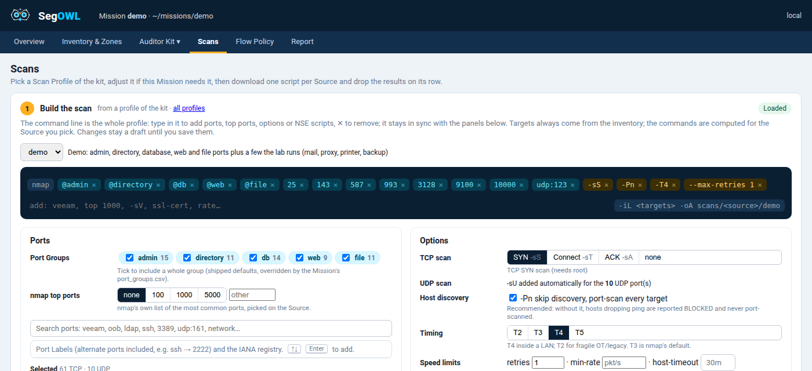

# Scanning from each Source

A **Source** is the IP you scan from. Every Source runs the same profile against the whole inventory minus its
own Machine (**Self**): the coverage is complete the first time.


## Build the scan

**Scans › Build the scan**: pick a Scan Profile of your kit, adjust it for this Mission, and the exact nmap
command is shown live.



- **Ports**: tick Port Groups, add nmap top ports, or search ports by product, tag or vendor (`veeam`, `oob`,
  `ldap`, `udp:161`…) in the Port Labels and the IANA registry.
- **Options**: each nmap option explained (SYN or connect, `-Pn`, timing, retries, rates, `-sV`, NSE scripts).
- **Commands for Source**: targets always come from the inventory, minus the Source's Machine.

Then download **one script per Source** and run it there.

## Run on site, drop the results

Results go in `scans/<source_ip>/`, any file name. In the app, drop the `.xml` / `.gnmap` / `.nmap` on the
Source's row: the views regenerate. By hand:

```bash
mkdir -p mission/scans/$SRC_IP && cd mission/scans/$SRC_IP
nmap -Pn -p- -oA broad <targets>          # through proxychains/SOCKS if pivoting
nmap -Pn -p 8443,9200 -oA follow-up <ip>  # any later follow-up, any parameters
```

A Source may have **any number of Scans**: they combine into its **Source View**. The most permissive state of
a port wins (an open port seen once proves the flow passed), and disagreements stay visible
([ADR 0001](../adr/0001-source-view-most-permissive-wins.md)).

## Good scans make good views

!!! tip "Keep the XML"
    XML is the reference format, the only one telling which ports were tested (**Coverage**): "tested and
    not seen" versus "never tested". For one scan written in several formats (`-oA`), xml > gnmap > nmap.

!!! warning "Avoid `--open`"
    Closed ports are what reveals a flow that crosses the segmentation (REACHABLE). `--open` throws them away.

!!! tip "Prefer `-Pn`"
    `-Pn` is auto-detected from the nmap header (or forced with `--pn`). Blocked targets then show as
    `filtered`, so BLOCKED, instead of being absent. Without it, hosts dropping ping are never port-scanned.

- `--top-ports N` works: nmap writes the expanded port list in the XML.
- The Interfaces of the Source's own Machine are always removed from its results: a machine scanning itself
  shows many "open" ports that would skew the matrix.

## Take a Scan out

Move its file into a sub-folder of the Source's folder, e.g. `scans/<source_ip>/excluded/`: it is no longer
read, only listed as excluded. Useful for a Scan that conflicts with the others (see the Conflicts table of the
Scans tab).

A Source folder that is not an inventory IP is **ignored** and listed in the terminal and the Anomalies tab.
The legacy layout `scans/<source_ip>.xml` is still accepted.
