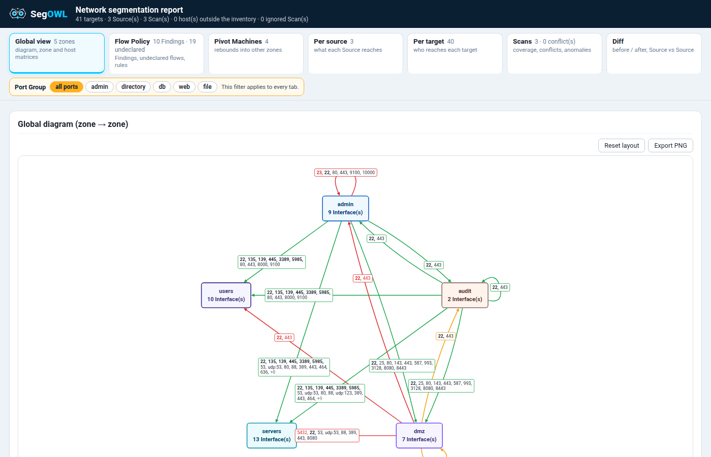

# SegOWL

**Network segmentation testing, from nmap to the report.** Scan from inside every Zone, see what really
crosses, set it against what the client says should.

| | What you get |
|---|---|
| 🎯 **Rigour** | The same optimised nmap from every Source, against the whole inventory. Nothing forgotten, nothing to rerun. |
| 👁️ **Visibility** | Thousands of nmap answers become one matrix and one diagram per Zone and per Source. |
| 📄 **Restitution** | Findings against the client's Flow Policy, diagrams ready for your report, one offline HTML file. |

## The audit path

Each step has its page:

1. [Getting started](guide/getting-started.md): install, the demo, the app.
2. [The Mission folder](guide/mission-folder.md): the inventory, Zones, Machines, names from the Scans.
3. [Scanning from each Source](guide/scanning.md): the scan builder, running on site, dropping the results.
4. [Auditor Kit](guide/auditor-kit.md): Scan Profiles, Port Groups, Port Labels, Kits.
5. [Flow Policy](guide/flow-policy.md): what may cross, Findings and undeclared flows.
6. [Reading the report](guide/report.md): verdicts, views, Diff, Pivot Machines, outputs.

No client network at hand? The [lab](guide/lab.md) rebuilds one with Docker.
